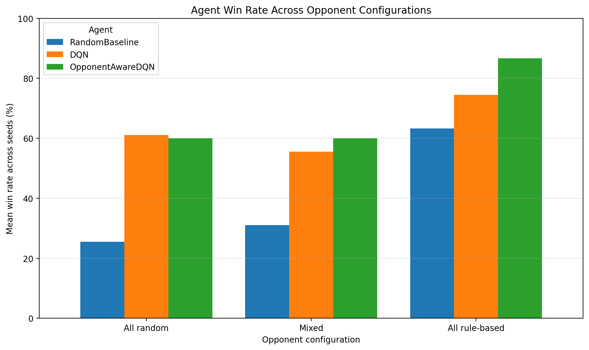

# Chef's Hat Gym — DQN with Opponent-Modelling Experiments

**Module:** 7043SCN — Generative AI and Reinforcement Learning  
**Task:** Task 2 — Reinforcement Learning  
**Variant:** Opponent Modelling  
**Environment:** [Chef's Hat Gym](https://github.com/pablovin/ChefsHatGYM)

## 1. Project overview

This project investigates Deep Q-Network (DQN) agents in the competitive, turn-based Chef's Hat card game. It compares a random legal-action baseline, an original DQN, and an opponent-aware DQN across three opponent-policy configurations.

The Opponent Modelling variant is implemented by augmenting the original observation with estimated pass/play behaviour for each opponent. The project evaluates whether these extra behavioural features are associated with improved performance against different opponent configurations.

The experiments report win rate, match score, and finishing position. Results are descriptive and apply to the tested policies, seeds, and training setup.

## 2. Research question

**Does adding simple opponent-behaviour features to a DQN improve its performance against different opponent-policy configurations in Chef's Hat Gym?**

## 3. Environment and interface

The project uses the Gym-compatible `chefshat-v1` environment from Chef's Hat Gym.

### Original observation

The tested environment returns a 228-element observation vector:

| Indices | Length | Meaning |
|---|---:|---|
| `0:11` | 11 | Board-related features |
| `11:28` | 17 | Current-hand features |
| `28:228` | 200 | Legal-action mask (`1` means legal) |

### Action handling

Although the environment advertises `Discrete(200)`, its tested `step()` method expects a 200-element action vector. The selected action is encoded as a one-hot vector. Both DQN agents output 200 Q-values and use the legal-action mask to avoid choosing invalid actions.

### Reward

The environment's immediate reward was observed to be zero during ordinary steps. Training therefore uses a match-outcome reward based on the agent's zero-based finishing position:

| Finishing position | Match score | Training reward |
|---:|---:|---:|
| 0 (first) | 3 | 1.000 |
| 1 (second) | 2 | 0.667 |
| 2 (third) | 1 | 0.333 |
| 3 (fourth) | 0 | 0.000 |

The terminal reward is the match score divided by 3. Because reward is delayed until the match ends, credit assignment is challenging. The training implementation treats the interval between two decisions by the learning agent as one transition and discounts by the number of intervening environment steps. This is an approximation in a multi-agent turn-based game.

## 4. Agents and algorithms

### Random baseline

The random baseline samples from the legal actions available in the current observation.

### Original DQN

The original learning agent is a Deep Q-Network (DQN) implemented with PyTorch.

- Input: 228 observation features.
- Hidden layers: 256 and 128 units with ReLU activations.
- Output: 200 Q-values.
- Legal-action masking.
- Experience replay buffer: capacity 20,000 transitions.
- Epsilon-greedy exploration during training.
- Smooth L1 (Huber) loss and gradient clipping at 1.0.
- Target network, periodically updated during training.
- Device: CPU in the tested setup.

DQN is a reasonable baseline because the observation is numerical and the environment exposes a fixed set of 200 action indices. The legal-action mask is essential because only a subset of actions is valid in any state.

### Opponent-aware DQN

The opponent-aware agent uses the same DQN approach but receives an augmented 234-element observation:

- The original 228 observation features.
- Two additional features for Agent 2: estimated pass rate and play rate.
- Two additional features for Agent 3: estimated pass rate and play rate.
- Two additional features for Agent 4: estimated pass rate and play rate.

The opponent model tracks observed pass/play actions separately for each opponent and resets its statistics at the start of each match. Smoothed estimates are used so the rates remain defined before any actions have been observed. The legal-action mask remains at indices `28:228`, and the action space remains 200 actions.

This is a deliberately simple opponent model. It describes aggregate pass/play behaviour; it does not predict the next specific action, infer hidden cards, or learn a detailed opponent strategy.

### Training configuration

Both DQN training scripts use the following main settings:

| Setting | Value |
|---|---:|
| Random seed | 42 |
| Training matches | 100 |
| Maximum environment steps | 100,000 |
| Target-network update interval | 10 matches |
| Replay capacity | 20,000 |
| Device | CPU |

See `dqn_agent.py`, `train_dqn.py`, and `train_opponent_aware.py` for implementation details. The training scripts rotate among the three opponent configurations and write logs, summaries, curves, and checkpoints to `results/` and `models/`.

## 5. Opponent configurations

| Configuration | Agent 2 | Agent 3 | Agent 4 |
|---|---|---|---|
| `all_random` | Random | Random | Random |
| `mixed` | Random | Rule-based | Rule-based |
| `all_rule_based` | Rule-based | Rule-based | Rule-based |

The rule-based policy chooses the first available legal action other than pass, if possible; otherwise it passes. This is a simple baseline heuristic, not an expert strategy.

## 6. Setup and reproducibility

### Requirements

- Python 3.11 (tested with Python 3.11.9)
- Git
- Packages listed in `requirements.txt`

### Windows PowerShell

Run these commands from the directory where you want to clone the repository:

```powershell
git clone https://github.com/chandu22200427-cell/7043SCN-Task2-ChefsHat-OpponentModelling.git
cd 7043SCN-Task2-ChefsHat-OpponentModelling
py -3.11 -m venv .venv
.\.venv\Scripts\Activate.ps1
python -m pip install --upgrade pip
python -m pip install -r requirements.txt
```

The installed package is imported in Python as `ChefsHatGym` (capitalisation matters). The tested setup uses `chefshatgym==3.0.0.1` and `gym==0.26.2`. The older Gym package may print a maintenance warning; this warning did not prevent the recorded experiments from completing.

### Run experiments

Run commands from the repository root with the virtual environment activated. Confirm each script and its required checkpoint are present before running it.

```powershell
python environment_test.py
python evaluate_opponents.py
python plot_opponent_results.py
python train_dqn.py
python fair_comparison.py
python plot_fair_comparison.py
python train_opponent_aware.py
python evaluate_opponent_aware.py
python plot_agent_comparison.py
```

Training creates `models/dqn_opponent_modeling.pt` and `models/dqn_opponent_aware.pt`. Evaluation and training CSV files and plots are saved under `results/`. Output files depend on which scripts have been run.

The full opponent-aware evaluation uses three seeds and takes longer than the smoke test. To reproduce the reported comparison, keep `SEEDS = [42, 123, 2026]` and `MATCHES_PER_CONFIGURATION = 30` in `evaluate_opponent_aware.py`.

## 7. Evaluation methodology

The evaluation compares three agent types:

- `RandomBaseline`
- `DQN`
- `OpponentAwareDQN`

Both trained DQNs are evaluated greedily with epsilon set to zero. Three seeds are used: **42, 123, and 2026**. Each agent/configuration/seed combination contains **30 matches**, giving **810 matches total** (3 agent types × 3 opponent configurations × 3 seeds × 30 matches).

The same seed values are used for each agent type, but different actions cause game trajectories to diverge; this is not a strictly paired-trajectory experiment. The reported mean win rates are calculated within each seed and then averaged across the three seed-level rates. The standard deviations below are across those three seed-level win rates, not confidence intervals.

### Latest recorded results

Mean win rate, average score, and average finishing position across the three seeds:

| Agent | Opponent configuration | Matches | Mean win rate | SD of seed win rates | Mean score | Mean finishing position |
|---|---|---:|---:|---:|---:|---:|
| Random baseline | All random | 90 | 0.256 | 0.051 | 1.589 | 1.411 |
| Original DQN | All random | 90 | 0.611 | 0.019 | 2.378 | 0.622 |
| Opponent-aware DQN | All random | 90 | 0.600 | 0.088 | 2.367 | 0.633 |
| Random baseline | Mixed | 90 | 0.311 | 0.051 | 1.678 | 1.322 |
| Original DQN | Mixed | 90 | 0.556 | 0.184 | 2.244 | 0.756 |
| Opponent-aware DQN | Mixed | 90 | 0.600 | 0.067 | 2.333 | 0.667 |
| Random baseline | All rule-based | 90 | 0.633 | 0.088 | 2.289 | 0.711 |
| Original DQN | All rule-based | 90 | 0.744 | 0.126 | 2.522 | 0.478 |
| Opponent-aware DQN | All rule-based | 90 | 0.867 | 0.033 | 2.733 | 0.267 |



Lower average finishing position is better because position 0 is first place. Win rate is the proportion of matches in which the agent finishes first.

### Interpretation

- Against all-random opponents, the original DQN has a slightly higher mean win rate than the opponent-aware DQN (61.1% versus 60.0%).
- Against mixed opponents, the opponent-aware DQN has a higher mean win rate (60.0% versus 55.6%).
- Against all-rule-based opponents, the opponent-aware DQN has the highest observed mean win rate (86.7%), compared with 74.4% for the original DQN and 63.3% for the random baseline.
- The opponent-aware DQN's seed-level win-rate standard deviation is lower than the original DQN's in the mixed and all-rule-based settings in this run, but three seeds provide only a limited view of variability.

These results suggest that the extra behavioural features may be useful for some opponent configurations, but they do not establish that opponent modelling alone caused the improvement. The models have different input dimensions and were trained separately, so the comparison does not isolate the effect of the added features perfectly. The findings apply to the tested policies, seeds, and training budget; they do not establish performance against all possible opponents.

## 8. Training results

The original DQN completed 100 training matches with an overall training win rate of approximately 0.49. The opponent-aware DQN completed 100 training matches with an overall training win rate of 0.40 in its recorded run.

Training win rates should not be compared directly with the evaluation win rates: training uses epsilon-greedy exploration and a rotating opponent schedule, while evaluation disables exploration and reports separate opponent configurations. These training figures are descriptive, not a controlled comparison of algorithm quality.

## 9. Experimental outputs

The repository includes or can generate the following outputs, depending on which scripts have been run:

| File | Purpose |
|---|---|
| `results/opponent_comparison.csv` | Per-match baseline opponent results |
| `results/opponent_comparison_summary.csv` | Baseline comparison summary |
| `results/opponent_win_rate.png` | Baseline win-rate plot |
| `results/opponent_average_score.png` | Baseline average-score plot |
| `results/opponent_finishing_position.png` | Baseline finishing-position plot |
| `results/dqn_training_log.csv` | Original DQN training match-level log |
| `results/dqn_training_summary.csv` | Original DQN training summary by configuration |
| `results/dqn_training_curve.png` | Original DQN training curve |
| `models/dqn_opponent_modeling.pt` | Original DQN checkpoint |
| `results/fair_comparison_raw.csv` | Original DQN and random-baseline match-level results |
| `results/fair_comparison_summary.csv` | Original DQN and random-baseline summary |
| `results/fair_comparison_win_rate.png` | Original DQN versus baseline win-rate plot |
| `results/fair_comparison_average_score.png` | Average-score comparison |
| `results/fair_comparison_finishing_position.png` | Finishing-position comparison |
| `models/dqn_opponent_aware.pt` | Opponent-aware DQN checkpoint |
| `results/opponent_aware_training_log.csv` | Opponent-aware training match-level log |
| `results/opponent_aware_training_summary.csv` | Opponent-aware training summary |
| `results/opponent_aware_training_curve.png` | Opponent-aware training curve |
| `results/opponent_aware_evaluation_raw.csv` | Raw results from the 810-match comparison |
| `results/opponent_aware_evaluation_summary.csv` | Aggregated three-agent evaluation summary |
| `results/agent_comparison_win_rate.png` | Three-agent win-rate comparison chart |

Commit only outputs that exist and are intended for submission. Do not commit `.venv/` or Python cache files.

## 10. Project structure

The final repository should contain the source files, tests, checkpoints, and result files that are actually committed. The key files for the opponent-modelling extension are:

```text
7043SCN-Task2-ChefsHat-OpponentModelling/
├── agents.py
├── dqn_agent.py
├── environment_check.py
├── environment_test.py
├── fair_comparison.py
├── train_dqn.py
├── opponent_model.py
├── train_opponent_aware.py
├── evaluate_opponent_aware.py
├── plot_agent_comparison.py
├── test_opponent_model.py
├── test_opponent_aware_state.py
├── test_opponent_aware_dqn.py
├── requirements.txt
├── README.md
├── models/
│   ├── dqn_opponent_modeling.pt
│   └── dqn_opponent_aware.pt
└── results/
    ├── opponent_aware_evaluation_raw.csv
    ├── opponent_aware_evaluation_summary.csv
    ├── opponent_aware_training_log.csv
    ├── opponent_aware_training_summary.csv
    ├── opponent_aware_training_curve.png
    └── agent_comparison_win_rate.png
```

Other existing scripts and results may remain in the repository if they are relevant to the project and documented accurately.

## 11. Limitations and critical reflection

1. **Limited training budget:** 100 training matches per run is a small budget. More training, independent training runs, and systematic hyperparameter experiments would strengthen the conclusions.
2. **Sparse terminal reward:** Delayed reward makes it difficult to assign credit to earlier decisions.
3. **Simple opponent model:** Pass/play rates capture only a small part of opponent behaviour and do not predict specific actions or infer opponent strategy strength.
4. **Simple rule-based opponent:** The heuristic is not an expert strategy and may not represent human play or stronger learned agents.
5. **Transition approximation:** The learning agent's next observation is obtained at its next decision after other players have acted. Discounting by intervening steps is an approximation.
6. **Evaluation uncertainty:** Only three seeds are used. Standard deviations are descriptive and are not confidence intervals.
7. **Not a perfectly isolated comparison:** The two DQNs have different observation dimensions and were trained separately. A controlled ablation with matched training budgets and multiple training seeds would be needed to attribute any difference specifically to opponent modelling.
8. **Environment compatibility:** The tested setup uses Gym 0.26.2 and emits a warning that the older Gym package is no longer maintained. Reproduce with the documented versions and record compatibility changes.

## 12. Conclusion

In the recorded 810-match evaluation, both trained agents outperform the random baseline in mean win rate across the tested configurations. The opponent-aware DQN performs particularly well against the all-rule-based configuration, while the original DQN is marginally better against all-random opponents. The mixed configuration also favours the opponent-aware DQN in this run.

These findings are promising but preliminary. The limited training budget, simple behavioural features, separate training runs, and seed variability prevent a strong causal conclusion that opponent modelling consistently improves DQN performance. Further controlled experiments with more training seeds and richer opponent representations are needed.

## 13. AI assistance declaration

AI tools were used to help draft and review parts of the documentation and to support debugging and explanation of implementation concepts. The student should verify the implementation, environment behaviour, results, and conclusions; annotate AI-assisted code or text as required by the module; and ensure they can explain the work independently. This declaration should be adjusted to accurately describe the assistance actually used and comply with the module's academic-integrity requirements.

## References

- Chef's Hat Gym source repository: https://github.com/pablovin/ChefsHatGYM
- Chef's Hat Gym documentation: https://chefshatgym.readthedocs.io/en/latest/
- PyTorch documentation: https://pytorch.org/docs/stable/
- Gym documentation: https://www.gymlibrary.dev/
